<p align="center">
  <a href="https://stnkypnky.github.io/ultimate_noita_companion/"></a>
</p>

<p align="center">
  <b>UNC</b> is the <b>U</b>ltimate <b>N</b>oita <b>C</b>ompanion.<br>
  Your wands, your run and your world, with no spoilers.
</p>

<p align="center">
  <a href="https://stnkypnky.github.io/ultimate_noita_companion/"></a>
  
  
  <a href="https://github.com/stnkypnky/ultimate_noita_companion/actions/workflows/deploy.yml"></a>
  <a href="LICENSE"></a>
</p>

<h3 align="center">Choose a perk</h3>

<p align="center">
  <a href="https://stnkypnky.github.io/ultimate_noita_companion/wand"></a>
  <a href="https://stnkypnky.github.io/ultimate_noita_companion/map"></a>
  <a href="https://stnkypnky.github.io/ultimate_noita_companion/run"></a>
</p>

<p align="center">
  <a href="#wand-builder">Wand Builder</a> ·
  <a href="#test-range">Test Range</a> ·
  <a href="#live-run">Live Run</a> ·
  <a href="#world-map">World Map &amp; Seed</a> ·
  <a href="#bestiary">Bestiary</a> ·
  <a href="#spells-perks-items">Spells, Perks, Items</a> ·
  <a href="#materials">Materials &amp; Alchemy</a> ·
  <a href="#no-spoilers">No Spoilers</a> ·
  <a href="#every-device">Every Device</a> ·
  <a href="#get-started">Get Started</a>
</p>

<p align="center"></p>

<a id="wand-builder"></a>
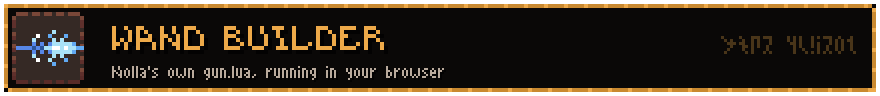

Drag spells onto a wand, or long-press and tap on a phone. UNC runs **Nolla's own `gun.lua`**, so every cast matches the game: multicasts, triggers and payloads, wrapping, Always Cast, mana, cast delay and recharge.

- **Perks on the wand.** Add the perks you have (Concentrated Spells, Glass Cannon, Critical Hit +, …) and the numbers match your run.
- **Charges.** Bombs and other limited spells run out, and Refill puts them back.
- **Saved builds** stay on your device. Zeta copies spells from your other saved wands, as it does in the game.
- **Share** a wand as a link or a QR code.

<p align="center">
  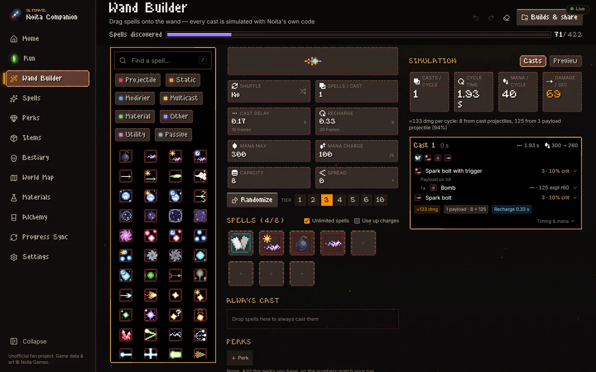
  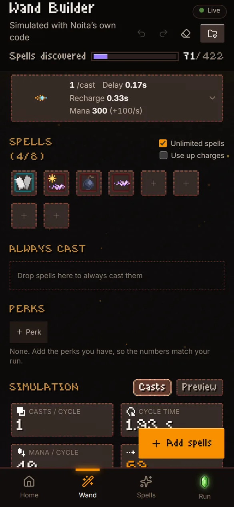
</p>

<a id="test-range"></a>
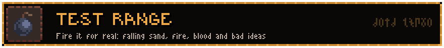

Before you trust a wand with your life, try it here. The Preview tab is a small Noita of its own.

- **Falling sand with the game's reactions**: dig through terrain, set it on fire, flood it, electrify the water.
- **Walk and levitate** with the real levitation bar, then aim and click, or switch on auto-fire.
- **Maps from real biomes**, and a statue, dummy or wall as the target. Live DPS shows what actually lands.
- Lightning, note songs, Plicates, Greek letters and the trigger loops behind projection wands all work.

<p align="center">
  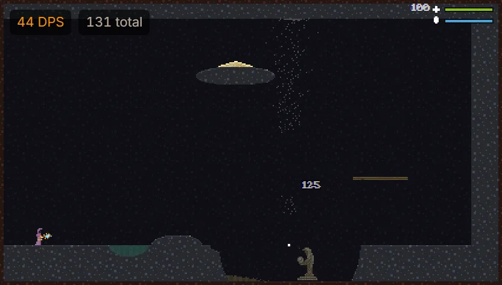
  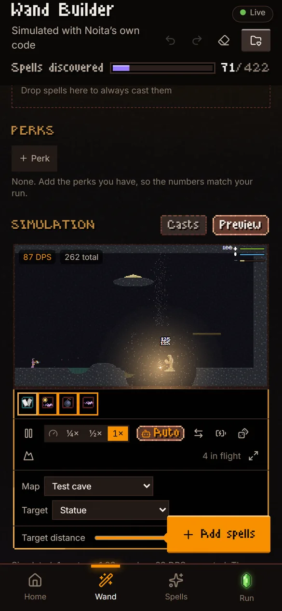
</p>

<a id="live-run"></a>
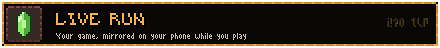

Install the small companion mod and UNC follows your game as you play: health, gold, biome, depth, wands with their real DPS, flasks, perks and every creature you meet. On a PC it's one dashboard; on a phone it's tabs under a HUD.

- **Where you are** on the map, plus the next Holy Mountain and when the next fungal shift is ready.
- **Found this run**: anything you discover mid-run unlocks in the app straight away.
- **Run history**: your last ten runs, with what killed you and where you fell.

<p align="center">
  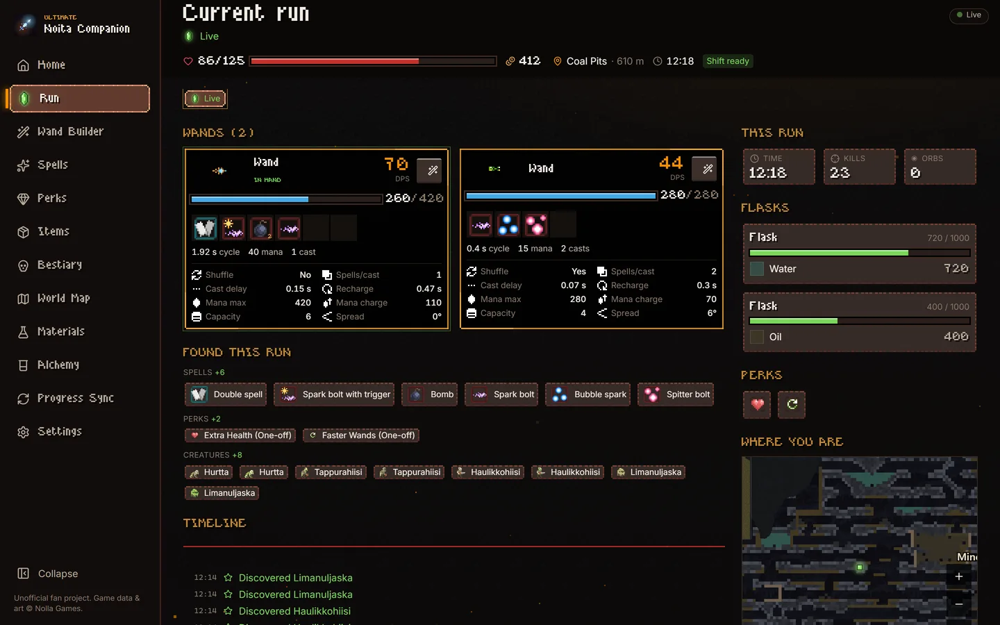
  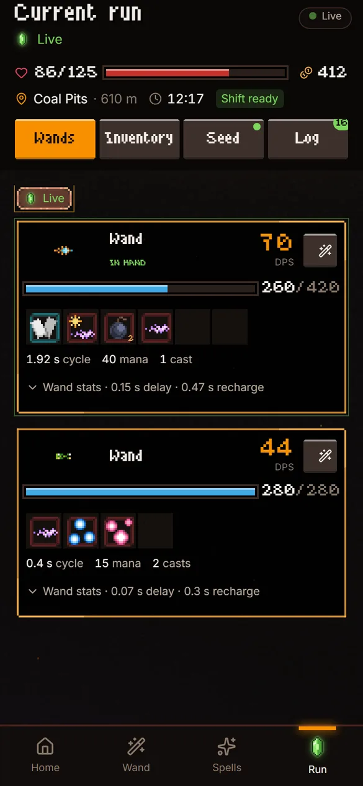
</p>

<a id="world-map"></a>
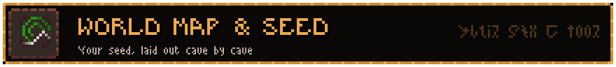

The whole world as the game lays it out. Enter your seed and every cave area is drawn from the game's own wang tiles. Rooms and points of interest sit where your seed puts them. Areas you haven't reached stay dark until you find them or choose to peek.

The **Seed** tab shows each Holy Mountain's perks and shop, the fungal shifts, and the biome modifiers. Tick the perks you take and the later mountains update.

<p align="center">
  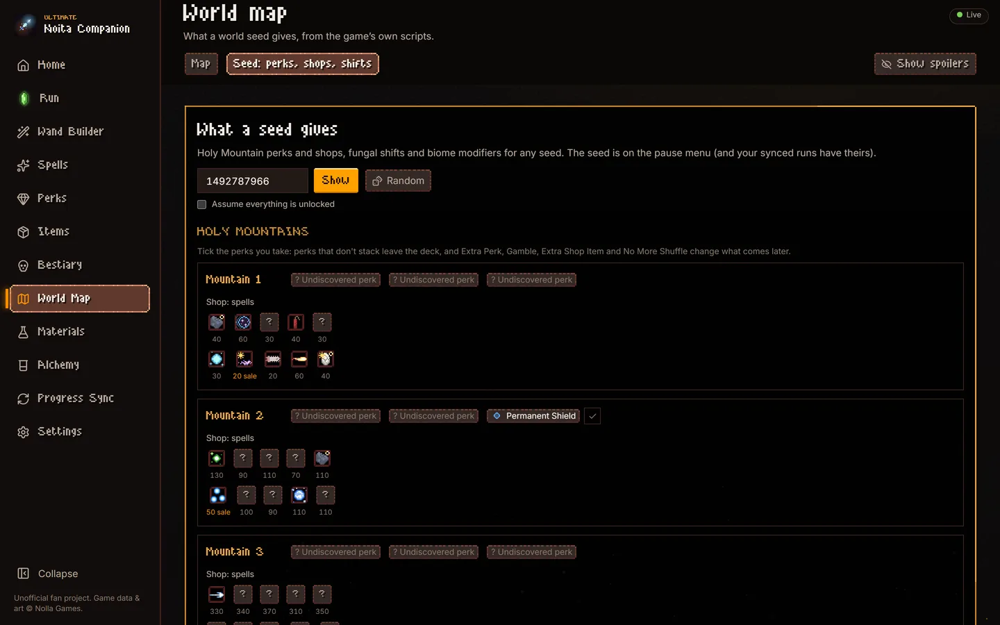
  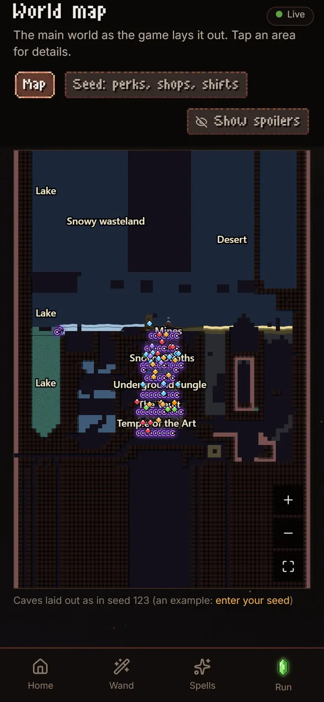
</p>

<a id="bestiary"></a>
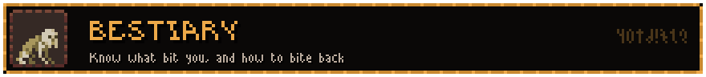

Every creature, animated. UNC tells you how each one fights, how to beat it, where it lives, what it drops and what it's weak to. It also keeps your record: how many you've killed and how many times one killed you. (Hurtta knows what it did.)

<p align="center">
  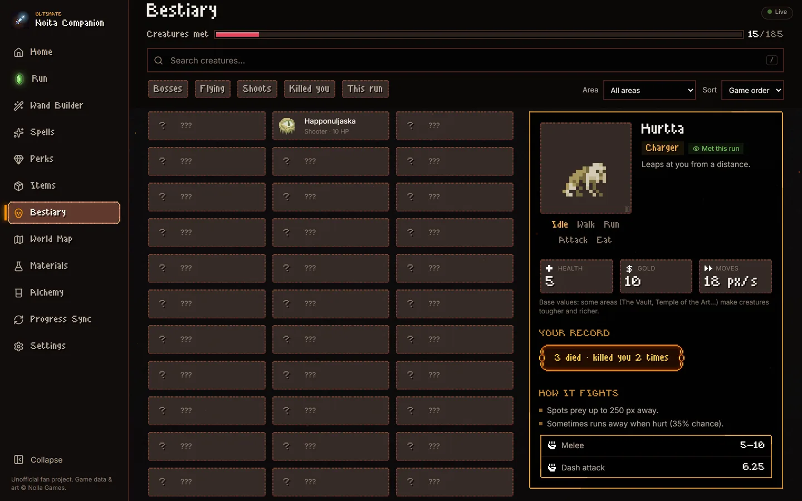
  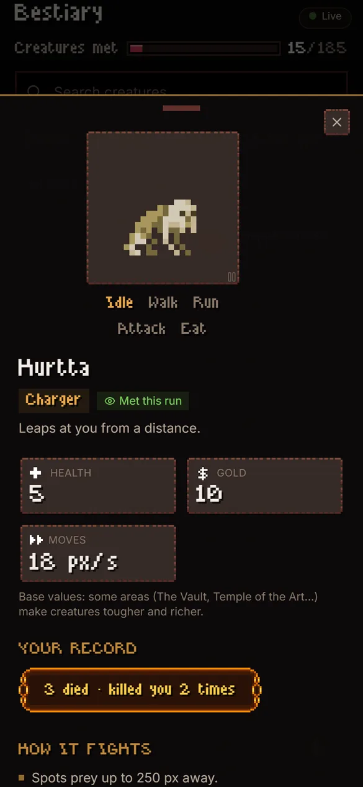
</p>

<a id="spells-perks-items"></a>
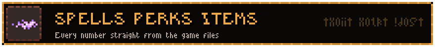

- **Spells**: real stats, damage types, explosions, lifetimes, and the tiers each spell spawns at.
- **Perks**: real odds from the game's perk deck, the actual numbers, how they stack, and tips.
- **Items**: what every chest, egg, stone and pickup does, and what's inside the chests.
- **Hidden mechanics** that the tooltips leave out, like speed damage and how hard things get thrown, with wiki links.

<p align="center">
  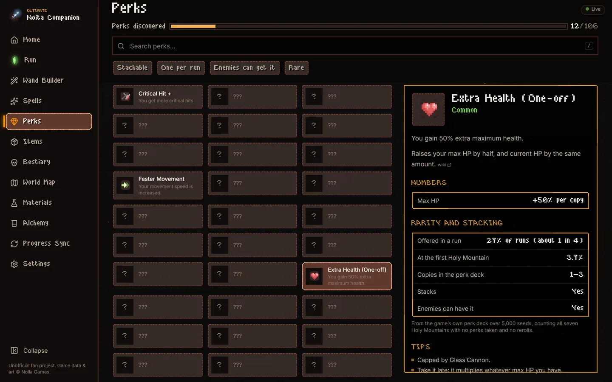
  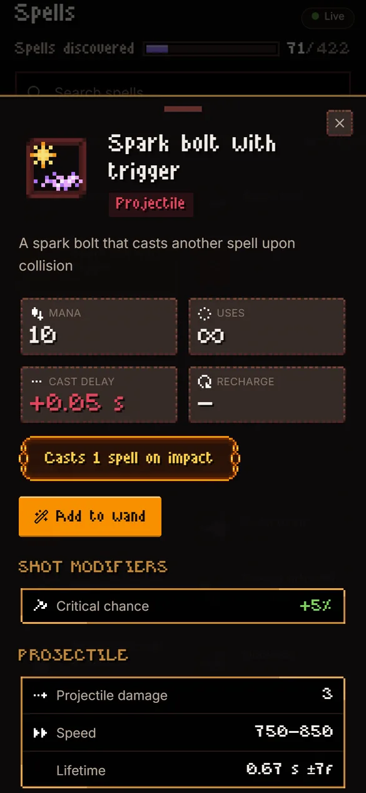
</p>

<a id="materials"></a>
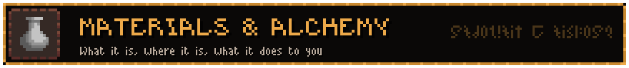

What every material is, where to find it (biomes, rooms, flasks, pouches, even what creatures bleed), and readable reactions like *Lava + Water = Rock + Steam*. Alchemy looks up Lively Concoction and Alchemic Precursor for any seed. Recipes stay hidden until you ask for them.

<p align="center">
  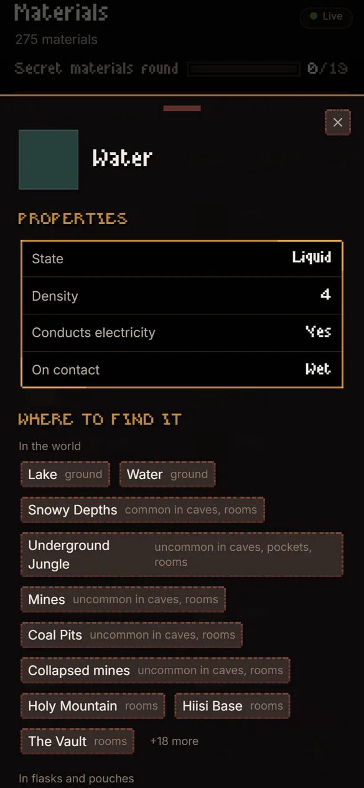
</p>

<a id="no-spoilers"></a>
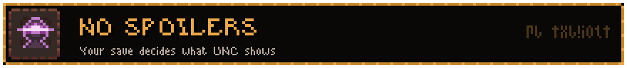

Noita is best when it surprises you, so UNC only shows what **your save** says you've found. Everything else is `???` until you discover it, or until you tap to reveal just that one thing.

Point UNC at your `save00` folder once. It reads the folder locally (nothing is uploaded) and keeps watching it, so new spells, perks and creatures appear as you find them.

<p align="center">
  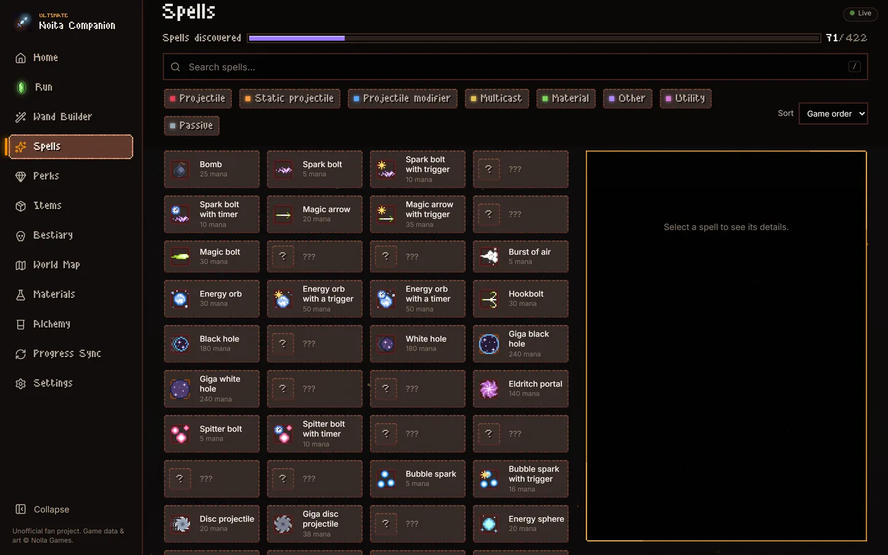
</p>

<a id="every-device"></a>
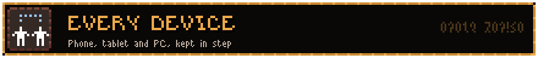

- **Pair once, stay in step.** Your phone, tablet and PC sync your progress, reveals, saved builds and settings directly with each other.
- **Installs like an app** and works fully offline: all game data, the Lua scripts and the simulator are cached.
- **Updates itself**, and paired devices show which one is out of date.

<p align="center">
  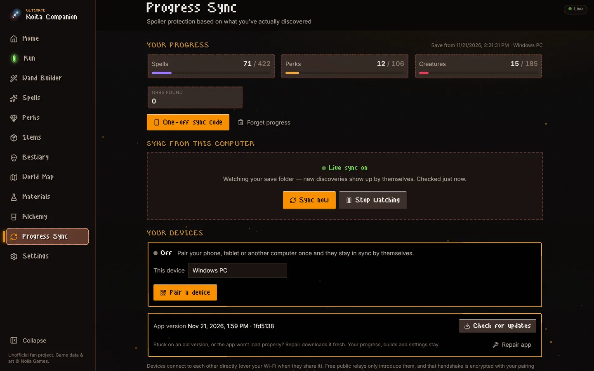
  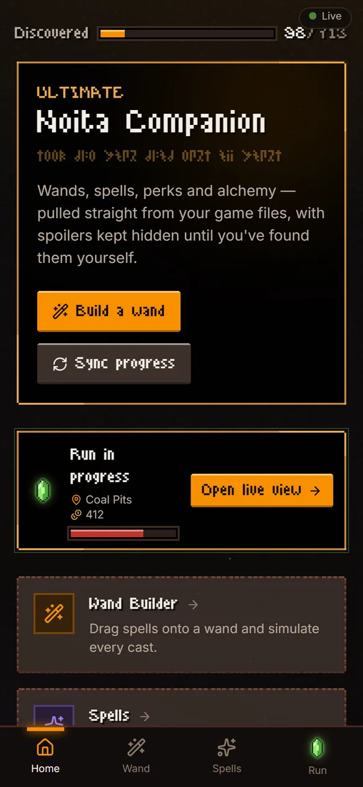
</p>

<a id="get-started"></a>
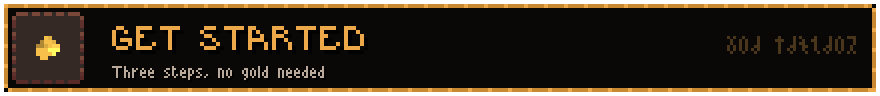

| | Step | |
|:-:|---|---|
| **1** | **Open UNC** | Go to **https://stnkypnky.github.io/ultimate_noita_companion/** and install it from the browser menu if you like. |
| **2** | **Bring your save** | On your PC, open **Progress Sync** → *Choose save folder* and pick `save00` (usually `%USERPROFILE%\AppData\LocalLow\Nolla_Games_Noita\save00`). This needs Chrome or Edge. In Brave, first turn on `brave://flags/#file-system-access-api`. Then pair your phone, or scan the one-off sync code. |
| **3** | **Optional: install the mod** | Download [`noita_companion.zip`](https://stnkypnky.github.io/ultimate_noita_companion/mod/noita_companion.zip) and unzip it into `Noita\mods`. In Noita, turn on **Noita Companion Live** in Mods and allow unsafe mods (it only writes `companion_live.json` into your save folder). Grab it again now and then: new versions add more to the Live Run page. |

> [!TIP]
> No save yet? Choose *Look around first*. Everything works, with spoiler protection hiding what you haven't found.

<a id="development"></a>
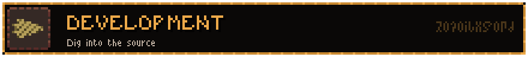

React + Vite + TypeScript. The wand simulator and seed tools run the game's own Lua in WebAssembly ([wasmoon](https://github.com/ceifa/wasmoon)) inside Web Workers.

```bash
npm install
npm run dev          # local dev server
npm run extract      # regenerate public/game/ from your local Noita install
npm test             # unit, simulator and seed golden tests
npm run build        # production build (also zips the mod)
npm run readme-art   # redraw this README's art from the game's fonts and sprites
```

`npm run extract` looks for Noita in your Steam libraries. If it's installed elsewhere, set `NOITA_PATH` to the game folder. It reads `data/data.wak` directly and runs the game's Lua with a small fake engine (`src/sim/lua/engine.lua`), the same one the browser uses. README screenshots come from `npm run readme-shots`, which runs against `vite preview` with a spoiler-free early-game save.

### Credits

- Seed alchemy: ported from [lamas_stats](https://github.com/lamia-zamia/lamas_stats) (WTFPL) and cross-checked against [noita-tools](https://github.com/TwoAbove/noita-tools) (MIT).
- World RNG and cave layouts (wang tiles): ported from [noita-tools](https://github.com/TwoAbove/noita-tools) (MIT) and checked against [noita-telescope](https://github.com/lymm37/noita-telescope) (MIT).
- Lua runtime: [wasmoon](https://github.com/ceifa/wasmoon). Device sync: [Trystero](https://github.com/dmotz/trystero).
- Mechanics notes link to the [Noita wiki](https://noita.wiki.gg/).

> [!NOTE]
> UNC is an unofficial fan project. It is not affiliated with or endorsed by Nolla Games.
> Game data, art and scripts under `public/game/` (and the art drawn from them in `docs/readme/`) are © Nolla Games and are included for reference.
> The source code is under the MIT license. Extracted game content is not covered; see [LICENSE](LICENSE).

<p align="center">
  <a href="https://stnkypnky.github.io/ultimate_noita_companion/"></a>
</p>
